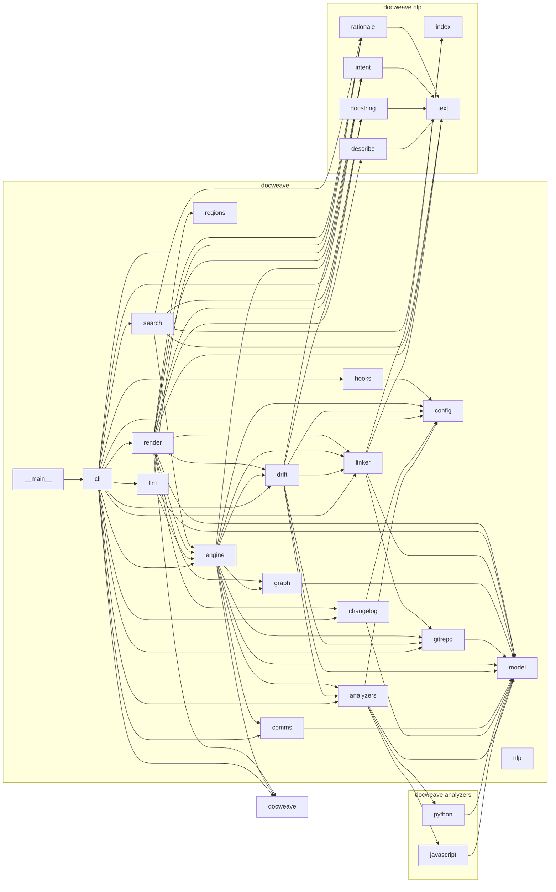

# DocWeave

**Living documentation that knows when it is stale.**

DocWeave reads two things most documentation tools keep apart - the *structure* of your code
(static analysis) and what your team *said* about it (commits, pull requests, issues, chat) - and
weaves them into one documentation site that:

- explains **what** each function does and **why** it is the way it is, quoting the discussion behind it;
- **detects drift**: docstrings, READMEs and guides that no longer match the code, with the commit that caused it;
- **regenerates in place** without destroying anything a person wrote;
- **gates commits and pull requests** so documentation stops rotting silently.

It is a single Python package with **no dependencies** (standard library only). An optional
`--llm` flag adds Claude-written summaries for undocumented code.

<!-- docweave:begin health -->
**Documentation health: 100/100** · 100% of 144 public symbols documented · 0 drift issues ([report](docs/health.md))
<!-- docweave:end health -->

## Quick start

```bash
pip install -e .
```

```bash
docweave generate
```

That analyses the current folder and writes `docs/`. To see everything it can do, build the
bundled demo repository (three fictional developers, three months of history, drift planted on
purpose) and point DocWeave at it:

```bash
python examples/make_demo_repo.py ../payflow-demo
```

```bash
docweave generate --root ../payflow-demo
```

```bash
docweave check --root ../payflow-demo
```

The output of that run is included under `examples/sample-output/` if you just want to look
(start with `examples/sample-output/docs/health.md`).

## What makes it different

### 1. Communication-aware drift detection

Most "is this documented?" tools only count docstrings. DocWeave asks whether the documentation is
still *true*, using five detectors:

| Detector | What it catches | How |
| --- | --- | --- |
| Claim checking | A docstring documents a parameter, return value or exception the code no longer has | Docstrings (Google, NumPy, Sphinx, JSDoc) are parsed into claims and compared with the AST |
| Reference rot | A README mentions `old_function` or a deleted file | Identifiers in Markdown are resolved against the code; missing ones are traced through git to the commit that removed them, with a "did you mean" taken from that commit's diff |
| Blame staleness | Code was rewritten but its docstring was not | `git blame` dates every line; a docstring older than most of its function body is suspect |
| Prose staleness | A guide describes a function whose signature has since changed | The same test, applied to the Markdown line that mentions the symbol |
| Anchored signatures | The same, without git | A state file remembers the signature each docstring was written against |

The NLP matters here: every commit is classified by **intent** (fix, feature, refactor, style,
...), and that intent weights the evidence. A `fix` that rewrites a function body makes its
docstring suspect; a formatter run that touches every line does not. That one idea removes most of
the false positives that make teams switch such checks off.

```text
HIGH   README.md:10  [dangling-reference] `convert_currency` is mentioned here but no longer exists in the code
         - removed in e26ca74 on 2026-02-02 by Lena Fischer: "Rename convert_currency to convert and switch to Decimal"
         - did you mean `convert`?
HIGH   payflow/gateway.py:18  [stale-docstring] `charge`: its signature and 64% of its code changed after the docstring was last edited
         - 2026-01-20 c8bf421 (fix, Priya Nair): fix(gateway): retry charges on 429 (#4)
```

### 2. The "why" is attached to the code

Each message is linked to the symbols it is about by combining three kinds of evidence into one
confidence score: **blame** (the commit wrote lines that still exist in the function), **mentions**
(the message names the symbol) and **wording similarity** (TF-IDF). Pull requests and issues
inherit the links of commits that reference them (`#12`). Sentences that carry reasoning -
"because", "instead of", "to avoid", "we decided" - are then extracted and shown next to the code:

> **`charge`** - History and rationale
> - 2026-01-20 · **pr** · Retry charges on 429 (`pr:4`, priya)
>   *Why:* We chose exponential backoff rather than a fixed delay because a fixed delay
>   re-synchronises all the retrying checkouts into another burst.

The same mining produces a **decision log** (`docs/decisions.md`) - an ADR trail nobody had to write.

### 3. Docs that people and the generator can both edit

Generated content lives between `<!-- docweave:begin ID -->` and `<!-- docweave:end ID -->` markers.
Regenerating rewrites only what is between them, so notes you add around a function's entry
survive. Put the same markers in any hand-written Markdown file (this README does) and DocWeave
keeps that region fresh; available ids are `health`, `modules`, `architecture` and `recent`.

Output is deterministic - no timestamps - so an unchanged project regenerates byte-identical files
and `git diff` stays quiet.

### 4. It enforces itself

```bash
docweave hook install
```

installs a pre-commit hook that blocks a commit only when the files *it touches* have serious
drift, so a project with existing problems can adopt it without fixing everything first.
`docweave hook install --sync` regenerates and stages the docs instead. `docweave init --ci`
writes a GitHub Actions workflow that annotates pull requests with drift (`--format github`) and
regenerates the docs on the main branch.

### 5. Questions in your team's words

```bash
docweave ask "why do we use Decimal for money"
```

Each symbol is indexed (BM25) together with the commits and discussions linked to it, so a
question phrased the way the team talks finds code that never uses those words.
`docweave why <symbol>` prints the full history and reasoning behind one function.

## Commands

| Command | Purpose |
| --- | --- |
| `docweave init [--ci] [--hook]` | Write `docweave.toml`; optionally the CI workflow and the git hook |
| `docweave generate [--llm]` | Analyse and (re)write the docs |
| `docweave check [--fail-on high\|medium\|low] [--staged] [--require-fresh] [--format text\|json\|github]` | Report drift; exit 1 on failure |
| `docweave why <symbol>` | Who wrote it, what is wrong with its docs, and the discussion behind it |
| `docweave ask "<question>" [--llm]` | Search code and discussion together |
| `docweave changelog` | Print a changelog grouped by commit intent |
| `docweave hook install [--sync]` / `uninstall` | Manage the pre-commit hook |
| `docweave comms pull` | Export PRs and issues with the `gh` CLI into `comms/` |
| `docweave watch` | Regenerate whenever a source file changes |

All commands take `--root PATH` and `--no-git`.

## What gets generated

| File | Contents |
| --- | --- |
| `docs/index.md` | Health score, module table, recent meaningful changes |
| `docs/api/<module>.md` | Signature, description, parameters, drift warnings, history and rationale, authorship for every public symbol |
| `docs/architecture.md` | Mermaid dependency graph, import cycles, external dependencies, coupling, churn x complexity hotspots |
| `docs/CHANGELOG.md` | Releases split at git tags, grouped by intent, each entry annotated with the API it touched |
| `docs/decisions.md` | Decisions and their reasoning mined from all communication |
| `docs/health.md` | Every drift issue with its evidence, plus coverage per module |

## Feeding it more than commits

Drop exports into `comms/` (configurable) and they join the analysis:

- `*.json` from `gh pr list --json number,title,body,author,mergedAt,url` or `gh issue list --json ...`
  (`docweave comms pull` does this for you);
- a Slack channel export (`[{"user_name": ..., "text": ..., "ts": ...}]`);
- `*.md` / `*.txt` meeting notes and ADRs.

## Optional: AI summaries

```bash
pip install anthropic
```

```bash
docweave generate --llm
```

Claude writes a short summary for each public symbol that has no docstring, given its source and
linked history. Results are cached by code fingerprint, so only symbols that actually changed are
ever sent again. Summaries are labelled as AI-generated in the output and never overwrite a
human docstring. Credentials come from `ANTHROPIC_API_KEY` or `ant auth login`; the model is set
by `llm_model` in `docweave.toml`.

## Configuration

`docweave init` writes a commented `docweave.toml`; `[tool.docweave]` in `pyproject.toml` also works.

| Key | Default | Meaning |
| --- | --- | --- |
| `out_dir` | `docs` | Where the site is written |
| `source` | `["."]` | Folders to analyse |
| `exclude` | `[]` | Extra patterns to skip (tests, virtualenvs and build output are skipped already) |
| `include_private` | `false` | Document `_private` symbols too |
| `comms_dir` | `comms` | Folder of exported discussions |
| `history_limit` | `2000` | Commits of history to read |
| `fail_on` | `high` | Severity at which `docweave check` fails |
| `changelog_sections` | feature, fix, perf, security, deprecation, refactor | Intents that appear in the changelog |

## How it works

<!-- docweave:begin architecture -->

<!-- docweave:end architecture -->

1. **Analyse** - `docweave.analyzers` parses Python with `ast` and scans JavaScript/TypeScript, producing
   symbols with signatures, parameters, complexity, raised exceptions and content fingerprints.
2. **Listen** - `docweave.gitrepo` reads the log, per-line blame and the "graveyard" of removed
   definitions; `docweave.comms` loads PRs, issues, chat and notes.
3. **Understand** - `docweave.nlp` classifies intent, parses docstrings into claims, extracts rationale
   and builds the retrieval index.
4. **Link** - `docweave.linker` scores every message against every symbol.
5. **Judge** - `docweave.drift` runs the detectors and computes the health score.
6. **Write** - `docweave.render` produces the pages and `docweave.regions` merges them with what is on disk.

<!-- docweave:begin modules -->
| Module | What it does | Public API | Documented | Main authors |
| --- | --- | ---: | ---: | --- |
| [`docweave`](docs/api/docweave.md) | DocWeave: living documentation woven from code structure and developer communication. | 0 | - | - |
| [`docweave.analyzers`](docs/api/docweave.analyzers.md) | Language analyzers and source discovery. | 3 | 100% | AashutoshR (100%) |
| [`docweave.analyzers.javascript`](docs/api/docweave.analyzers.javascript.md) | Structural analysis of JavaScript / TypeScript. | 3 | 100% | AashutoshR (100%) |
| [`docweave.analyzers.python`](docs/api/docweave.analyzers.python.md) | Static analysis of Python source using the standard ``ast`` module. | 2 | 100% | AashutoshR (100%) |
| [`docweave.changelog`](docs/api/docweave.changelog.md) | Group commits into a release-by-release changelog, using classified intent rather than prefixes. | 4 | 100% | AashutoshR (100%) |
| [`docweave.cli`](docs/api/docweave.cli.md) | Command-line interface: ``docweave <command>``. | 11 | 100% | AashutoshR (100%) |
| [`docweave.comms`](docs/api/docweave.comms.md) | Load developer communication that lives outside git: PRs, issues, chat exports, notes. | 2 | 100% | AashutoshR (100%) |
| [`docweave.config`](docs/api/docweave.config.md) | Configuration: defaults, overridden by ``docweave.toml`` or ``[tool.docweave]`` in pyproject. | 4 | 100% | AashutoshR (100%) |
| [`docweave.drift`](docs/api/docweave.drift.md) | Detect documentation that no longer matches the code. | 16 | 100% | AashutoshR (100%) |
| [`docweave.engine`](docs/api/docweave.engine.md) | The analysis pipeline: code structure + developer communication -> one linked model. | 5 | 100% | AashutoshR (100%) |
| [`docweave.gitrepo`](docs/api/docweave.gitrepo.md) | Read developer communication and line-level authorship out of git. | 12 | 100% | AashutoshR (100%) |
| [`docweave.graph`](docs/api/docweave.graph.md) | Module dependency graph: internal edges, external dependencies, cycles and a Mermaid drawing. | 4 | 100% | AashutoshR (100%) |
| [`docweave.hooks`](docs/api/docweave.hooks.md) | Keep docs in sync automatically: a git pre-commit hook and a CI workflow template. | 3 | 100% | AashutoshR (100%) |
| [`docweave.linker`](docs/api/docweave.linker.md) | Link developer communication to the code it is about. | 7 | 100% | AashutoshR (100%) |
| [`docweave.llm`](docs/api/docweave.llm.md) | Optional AI layer (``--llm``): Claude writes summaries for code nobody documented. | 3 | 100% | AashutoshR (100%) |
| [`docweave.model`](docs/api/docweave.model.md) | Core data model shared by analyzers, the linker, drift detection and renderers. | 16 | 100% | AashutoshR (100%) |
| [`docweave.nlp`](docs/api/docweave.nlp.md) | Dependency-free NLP building blocks: tokenising, intent, docstrings, rationale, retrieval. | 0 | - | - |
| [`docweave.nlp.describe`](docs/api/docweave.nlp.describe.md) | Synthesise a one-line description for symbols nobody documented. | 1 | 100% | AashutoshR (100%) |
| [`docweave.nlp.docstring`](docs/api/docweave.nlp.docstring.md) | Parse docstrings (Google, NumPy, Sphinx and JSDoc styles) into structured claims. | 2 | 100% | AashutoshR (100%) |
| [`docweave.nlp.index`](docs/api/docweave.nlp.index.md) | A small inverted index offering BM25 ranking and TF-IDF cosine similarity. | 5 | 100% | AashutoshR (100%) |
| [`docweave.nlp.intent`](docs/api/docweave.nlp.intent.md) | Classify what a piece of developer communication is *doing*: fixing, adding, refactoring... | 1 | 100% | AashutoshR (100%) |
| [`docweave.nlp.rationale`](docs/api/docweave.nlp.rationale.md) | Mine the *why* out of developer communication. | 3 | 100% | AashutoshR (100%) |
| [`docweave.nlp.text`](docs/api/docweave.nlp.text.md) | Tokenising, identifier splitting, light stemming and sentence segmentation. | 5 | 100% | AashutoshR (100%) |
| [`docweave.regions`](docs/api/docweave.regions.md) | Managed regions: let generated and hand-written text share a file without clobbering. | 4 | 100% | AashutoshR (100%) |
| [`docweave.render`](docs/api/docweave.render.md) | Render an :class:`~docweave.engine.Analysis` as a Markdown documentation site. | 26 | 100% | AashutoshR (100%) |
| [`docweave.search`](docs/api/docweave.search.md) | Ask questions of the codebase: BM25 retrieval over symbols and the communication linked to them. | 2 | 100% | AashutoshR (100%) |
<!-- docweave:end modules -->

## How well tested it is

- **68 automated tests**, run on Python 3.13 and 3.14 (Windows). They build the demo repository in
  a temporary folder and assert that every planted problem is found - and that the
  formatting-only commit is *not* flagged.
- **Stress-tested on real code** it was not written for: about 460 Python files (parts of the
  standard library plus the `pip`, `rich`, `requests`, `urllib3` and `packaging` sources) and 184
  JavaScript files from `npm`. No crashes. Every high-severity finding that was inspected by hand
  was a genuine documentation bug in those projects, for example a docstring describing a parameter
  called `control_codes` on a function whose parameter is `control`.
- **The AI layer** is covered by tests against a fake SDK (caching, re-sending only changed code,
  refusals, model routing) and its request signature was checked against the real `anthropic`
  package. A request with a deliberately invalid key reaches the API and is reported cleanly.

## Limitations

- Python analysis is exact (it uses the real parser). JavaScript/TypeScript analysis is a scanner,
  not a parser. It handles functions, arrow functions, function expressions, classes, methods,
  interfaces, type aliases, enums, generics, callback and object-literal types, and CommonJS
  exports - but declarations nested inside other functions are ignored, and exotic syntax can
  still be missed.
- Blame-based staleness is evidence, not proof - it reports *"this is suspect, and here is the
  commit"*. Claim checking and reference rot are precise.
- The history-based features (rationale, blame staleness, rename tracing) have been exercised on
  the scripted demo history, not yet on a large real-world repository.
- A pre-commit hook cannot know the hash of the commit it is part of, so with `--sync` the
  history-derived sections (changelog, rationale) trail by one commit; the CI job closes the gap.
- `--llm` has not been run with real credentials, so the quality of the generated summaries is
  unmeasured. `docweave comms pull` is tested with a simulated `gh`, not a live one.
- Not yet tried on macOS or Linux.

## Development

```bash
python -m unittest discover -s tests -v
```
