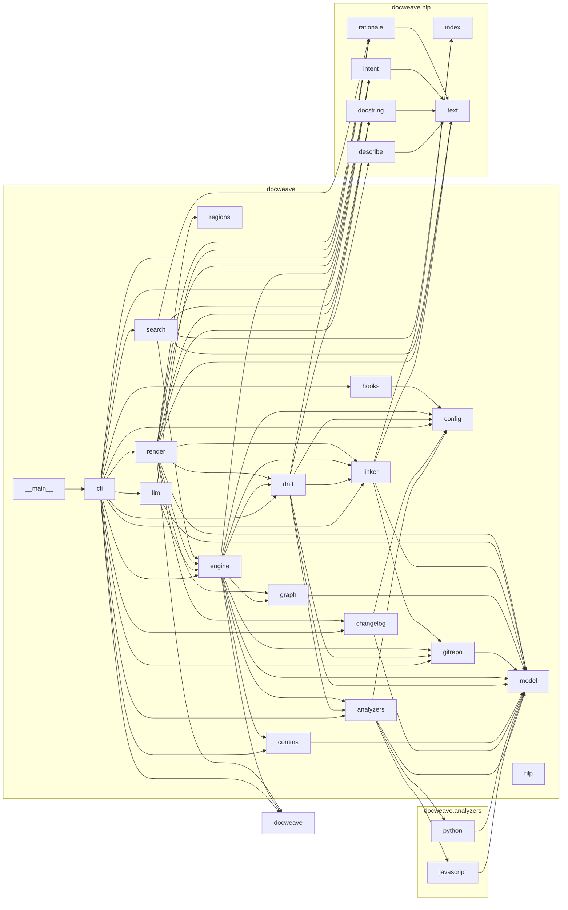

<!-- docweave:begin title -->
# Architecture
<!-- docweave:end title -->

<!-- docweave:begin health -->
**Documentation health: 100/100** · 100% of 144 public symbols documented · 0 drift issues ([report](health.md))
<!-- docweave:end health -->

<!-- docweave:begin graph -->
## Module dependencies

An arrow means *imports*.

<!-- docweave:end graph -->

<!-- docweave:begin cycles -->
## Import cycles

None found.
<!-- docweave:end cycles -->

<!-- docweave:begin external -->
## External dependencies

`anthropic`
<!-- docweave:end external -->

<!-- docweave:begin coupling -->
## Most depended-upon modules

Changes here ripple furthest, so these deserve the best documentation.

| Module | Imported by | Imports | Lines |
| --- | ---: | ---: | ---: |
| `docweave.model` | 12 | 0 | 168 |
| `docweave.nlp.text` | 7 | 0 | 88 |
| `docweave.config` | 6 | 0 | 85 |
| `docweave.engine` | 4 | 10 | 99 |
| `docweave.gitrepo` | 4 | 1 | 182 |
| `docweave.linker` | 4 | 4 | 188 |
| `docweave.nlp.intent` | 4 | 1 | 90 |
| `docweave.nlp.rationale` | 4 | 1 | 67 |
| `docweave` | 3 | 0 | 4 |
| `docweave.analyzers` | 3 | 4 | 61 |
| `docweave.drift` | 3 | 7 | 395 |
| `docweave.nlp.docstring` | 3 | 1 | 171 |
| `docweave.changelog` | 2 | 2 | 46 |
| `docweave.comms` | 2 | 1 | 122 |
| `docweave.graph` | 2 | 1 | 121 |
<!-- docweave:end coupling -->
