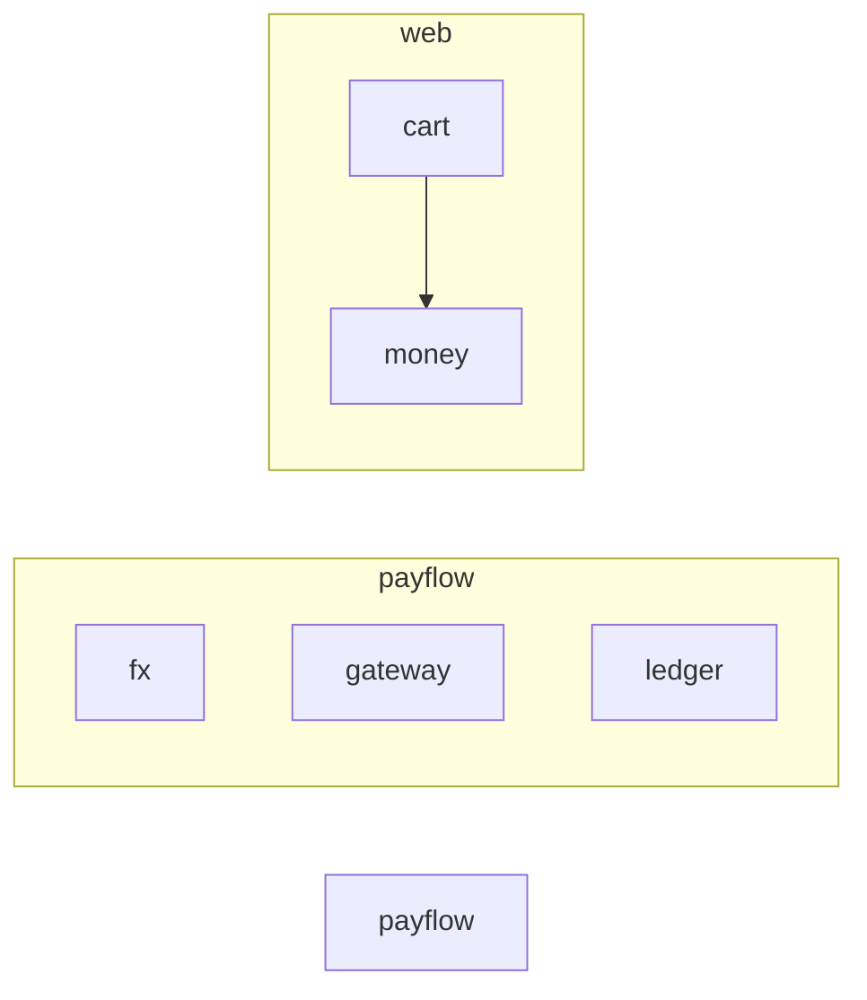

<!-- docweave:begin title -->
# Architecture
<!-- docweave:end title -->

<!-- docweave:begin health -->
**Documentation health: 36/100** · 91% of 11 public symbols documented · 11 drift issues ([report](health.md))
<!-- docweave:end health -->

<!-- docweave:begin graph -->
## Module dependencies

An arrow means *imports*.

<!-- docweave:end graph -->

<!-- docweave:begin cycles -->
## Import cycles

None found.
<!-- docweave:end cycles -->

<!-- docweave:begin coupling -->
## Most depended-upon modules

Changes here ripple furthest, so these deserve the best documentation.

| Module | Imported by | Imports | Lines |
| --- | ---: | ---: | ---: |
| `web.money` | 1 | 0 | 4 |
| `payflow` | 0 | 0 | 2 |
| `payflow.fx` | 0 | 0 | 18 |
| `payflow.gateway` | 0 | 0 | 47 |
| `payflow.ledger` | 0 | 0 | 34 |
| `web.cart` | 0 | 1 | 24 |
<!-- docweave:end coupling -->

<!-- docweave:begin hotspots -->
## Hotspots

Files that are both complex and frequently changed - where stale documentation costs the most.

| File | Commits | Complexity | Undocumented public symbols |
| --- | ---: | ---: | ---: |
| [`payflow/gateway.py`](api/payflow.gateway.md) | 5 | 8 | 0 of 4 |
| [`payflow/ledger.py`](api/payflow.ledger.md) | 3 | 7 | 0 of 3 |
| [`web/cart.js`](api/web.cart.md) | 2 | 2 | 0 of 2 |
| [`payflow/fx.py`](api/payflow.fx.md) | 2 | 1 | 0 of 1 |
| [`web/money.js`](api/web.money.md) | 1 | 1 | 1 of 1 |
<!-- docweave:end hotspots -->
